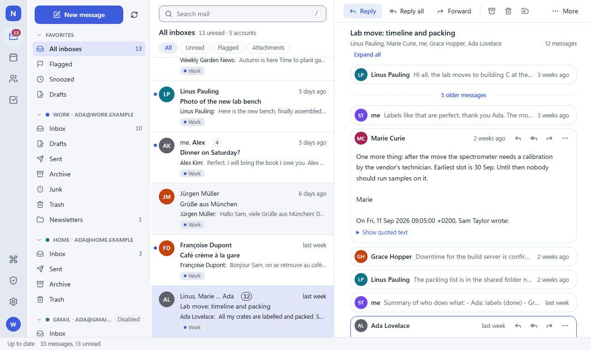
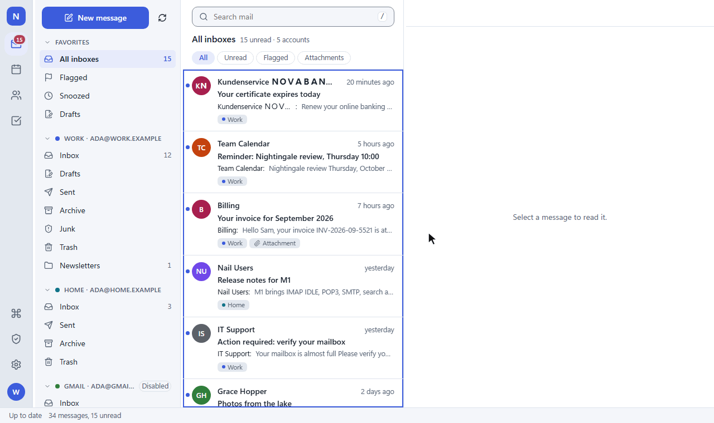
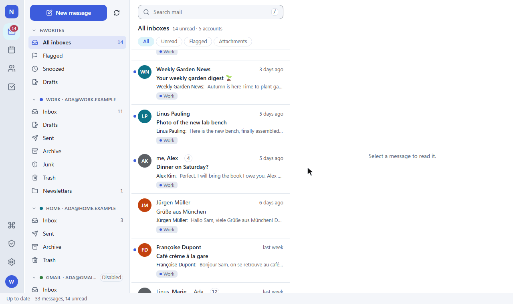
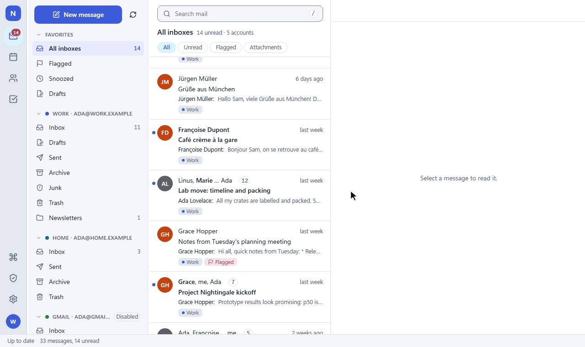
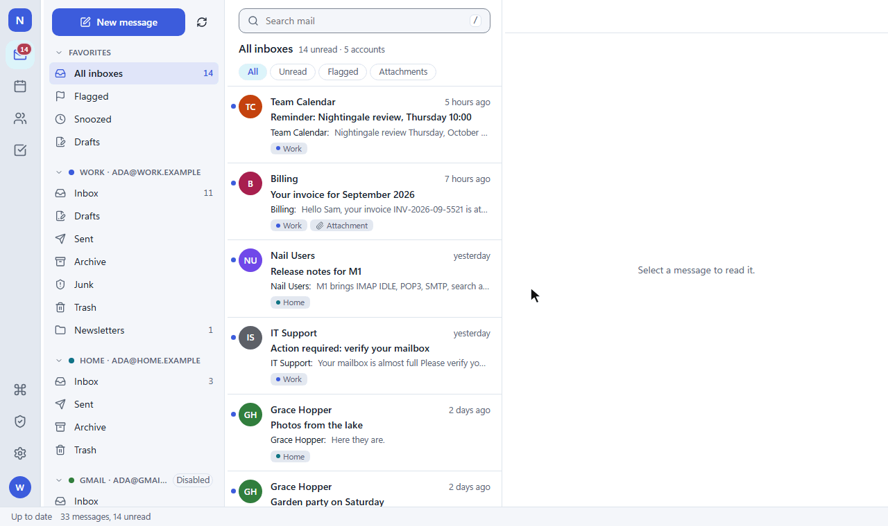
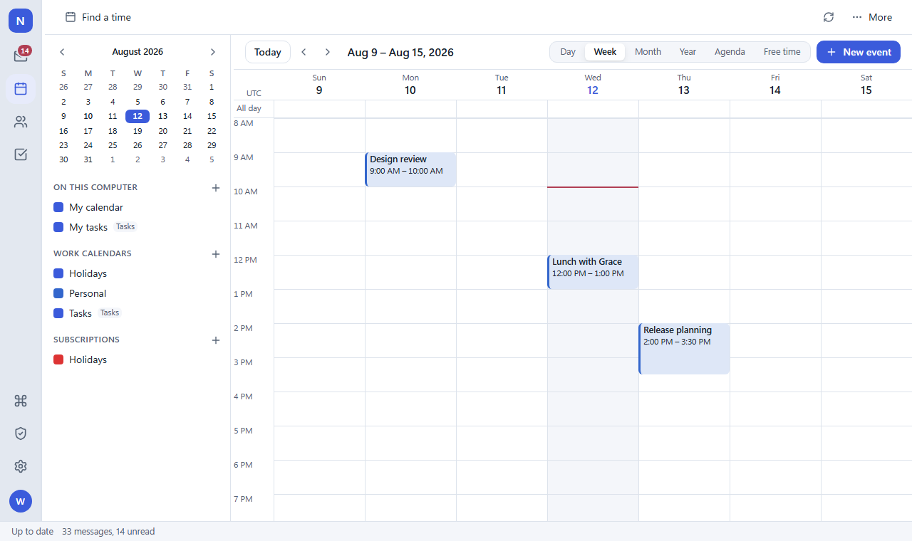
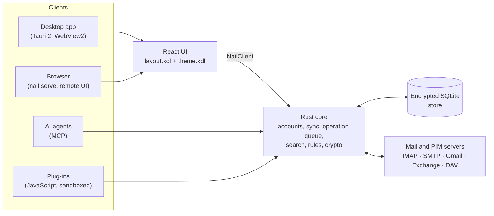

<!-- The GitHub front page centres its banner and shows its images at full width, which only HTML can do; the banner image is the title. -->
<!-- markdownlint-disable MD033 MD041 -->

<p align="center">
  
</p>

<p align="center">
  <b>An email, calendar, contacts and tasks client with a fast Rust core, a modern UI you can reshape, and your data on your machine.</b><br>
  Windows desktop app · web UI · MCP access for AI agents · plug-ins
</p>

<p align="center">
  <a href="#a-tour">Tour</a> ·
  <a href="#what-nail-does">Features</a> ·
  <a href="#getting-started">Getting started</a> ·
  <a href="#how-it-is-built">Architecture</a> ·
  <a href="userDocs/en/">Manual</a> ·
  <a href="#license">License</a>
</p>

---



## Why “Nail”?

Because it is the last nail in Outlook’s coffin. Nail does what a desktop mail
client should do (many accounts in one inbox, real conversations, a calendar
that speaks every protocol, solid encryption) without the weight, the lock-in
or the ads. And everything you see is defined by two plain text files, so
nothing about it is set in stone.

## A tour

### Safe by default

HTML mail renders in a sandbox that never runs scripts, remote images stay
blocked until you allow a sender, links that hide their real target and senders
that disguise themselves are flagged, and the complete source of every message
is one click away.



### Conversations that read like a conversation

Rows group a whole thread, your own replies from Sent included. The reader shows
it as a feed of cards: the unread message and the newest open, older ones folded
away until you want them.


### Triage in one click, undo in one click

Archive, delete, label, snooze or move a whole conversation at once. Every
action can be undone, also when an AI agent or a plug-in did it.



### Five themes, live

Frost, Nocturne, Sage, Graphite and High contrast ship built in, each in a
comfortable and a compact density, or following Windows' light and dark mode.
Every colour, size and pane is a token in `theme.kdl` and `layout.kdl`, editable
in the app or in any text editor.



### Arrange it your way

Customize the layout right in the window: pick a preset, drag panes to
another side, hide or remove them, and add widgets such as a mini calendar
or today's agenda. Every change is undoable and lands in `layout.kdl`;
toolbars can be customized the same way.


### Every action a few keys away

`Ctrl+K` opens the command palette with every action of the app; key sequences
like `g c` (go to the calendar) work too.


### Your folders, on the server

Create, rename, move and delete folders right from the folder pane. Changes are
queued, work offline and reach the server in order.


### Writing

Plain text, HTML or Markdown, signing and encryption (OpenPGP with Autocrypt, or
S/MIME) per message, send later, and drafts that are saved as you type.



### The calendar, too

Day, week, month, year, agenda and free-time views across CalDAV, Exchange,
Google and subscribed ICS calendars, with invitations answered right from the
mail.



## What Nail does

- **Accounts**: IMAP (with IDLE), POP3, SMTP, Gmail API, Exchange Online (Graph) and Exchange Server (EWS), CalDAV / CardDAV, ICS subscriptions; setup finds the settings from the address
- **Mail**: Unified inbox, conversations, fast full-text and server search, rules (also as Sieve on the server), snooze, junk filtering, Focused Inbox, labels and categories, vacation replies, send later
- **Calendar, contacts, tasks**: Every view of a calendar, invitations and free/busy (iTIP / iMIP), address books, to-dos, reminders
- **Security**: OpenPGP and S/MIME with Autocrypt, smart cards, sender authentication (DKIM, SPF, DMARC) per message, sandboxed HTML, remote content through a privacy proxy, look-alike sender and link warnings, encrypted local store
- **Customization**: Themes and layouts as plain KDL files with in-app editors, movable and resizable windows, a toolbar customizer, responsive from phone to wide screen
- **Automation**: An MCP server, so AI agents can read and act on mail and calendars with per-action approval; JavaScript plug-ins with a typed API and `npm create nail-plugin`
- **Desktop**: Windows installer and updates, tray and start minimized, default mail app with Simple MAPI ("Send to mail recipient"), print to PDF
- **Everywhere else**: `nail serve` runs the same UI in a browser; the remote UI is protected by passkeys or password + TOTP
- **Your data**: Import from and export to standard formats, backups, a recovery key; nothing leaves your machine unless you send it

## Getting started

Nail is at version 0.8.0, a preview for Windows; macOS, Linux and mobile
come later. Until the first release is published, build it from source:

```sh
npm ci                                              # npm workspaces: ui, e2e, packages
npm run build                                       # the UI (ui/dist)
cargo run -p nail-cli -- serve --seed demo --open   # the web UI with demo mail
npm run tauri dev                                   # the desktop app with hot reload
```

Prerequisites (Rust stable with MSVC, Node 26), every command, the test suites
and the installer build are in [`docs/dev-setup.md`](docs/dev-setup.md). The
user manual is in [`userDocs/en/`](userDocs/en/).

## How it is built



The core owns all data and logic; every write goes through one operation queue,
so offline work, undo and agents behave the same everywhere. The UI is a
renderer for `layout.kdl` and `theme.kdl`; every text comes from Fluent
catalogs. Where the code lives: [`docs/architecture.md`](docs/architecture.md);
the design: [`docs/design.md`](docs/design.md); decisions:
[`docs/adr/`](docs/adr/).

The animations on this page are recorded from the demo data with
`npm run readme:media`.

## License

Nail is licensed under the
[GNU Affero General Public License v3.0 or later](LICENSE): you may use,
change and share it, also commercially; if you distribute a changed Nail or
offer it to others over a network, you make its source available under the
same license. Other license terms (for example for a closed product built on
Nail) are available from the maintainer.

The plug-in kit ([`packages/plugin-api`](packages/plugin-api/),
[`packages/create-nail-plugin`](packages/create-nail-plugin/)) and the
[example plug-ins](examples/) are MIT-licensed, so plug-ins can use any license.

Contributions are welcome under the contributor license agreement in
[`CONTRIBUTING.md`](CONTRIBUTING.md).

Nail is an independent project and is not affiliated with Microsoft. Outlook is
a trademark of Microsoft Corporation.
