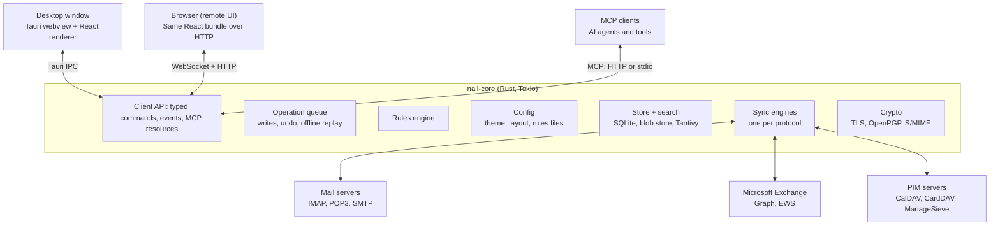
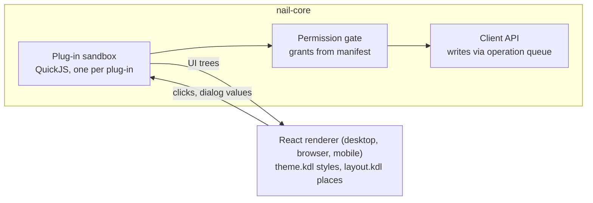
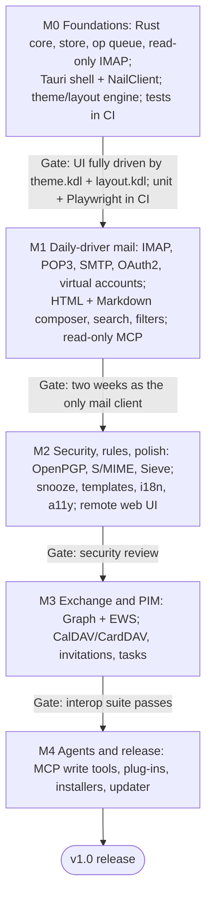

# Nail — Email & PIM Client Design Document

Sep 29, 2026 · Living version: a published page, not linked here

## Overview

Nail is an email and PIM client for desktop and mobile whose entire UI is defined by two user-editable files, and whose data is fully available to AI agents over MCP. It covers everything a mainstream client does (Thunderbird, Outlook, Apple Mail), plus four distinguishing features.

**Distinguishing features**

1. **Total UI customization.** One theme file (every visual property) and one layout file (every structural property). The built-in UI is itself just the default pair of files; nothing is hard-coded.
2. **HTML and Markdown authoring.** A WYSIWYG HTML editor and a Markdown editor, both first-class, with clean multipart output.
3. **MCP-native.** Every piece of mail, calendar and contact data is exposed as MCP resources and tools, with scoped permissions.
4. **Virtual accounts.** Any set of accounts can be merged into one virtual account with unified folders, threads and search.

**Goals**

- Standards-complete mail (IMAP, POP3, SMTP, OpenPGP, S/MIME, OAuth2) plus Microsoft Exchange, both on-premises and Exchange Online.
- Calendar, contacts and tasks over CalDAV/CardDAV, with iTIP invitations.
- Client-side filters plus server-side Sieve.
- Fast and offline-capable: local store, instant search, background sync.
- Windows first, then macOS, Linux, Android and iOS, from one Rust core and one React renderer.

**Non-goals for v1**

- A hosted web service. Browser and mobile access come from the user's own Nail instance or the native apps.
- Exchange ActiveSync (EWS and Microsoft Graph already cover Exchange).
- Built-in AI features. Nail exposes data over MCP; the agent brings the intelligence.
- Running as a mail server.

## Architecture

Nail has a Rust core that owns all data and protocols, and a TypeScript + React UI that only renders. A Tauri 2 shell joins them. The UI never talks to a mail server directly.



The desktop window, a remote browser and MCP agents all go through the same client API, so each one sees the same data and the same rules.

**Components**

- **nail-core (Rust library).** Protocol engines, sync engine, local store, search index, crypto, rules engine, MIME parsing and building. Has no UI dependencies, so it is testable headless.
- **Tauri 2 shell (Rust).** Hosts nail-core in-process and exposes it to the UI as typed IPC commands (request/response) and events (push: new mail, sync progress, reminders). Keeps running in the system tray when the window closes, so sync, filters, reminders and MCP keep working.
- **React renderer (TypeScript).** Reads the layout file and builds the component tree from a widget registry. Compiles the theme file to CSS custom properties plus per-component style rules. Holds no business logic and never assumes it runs inside Tauri.
- **Message view sandbox.** HTML mail renders in a sandboxed iframe: scripts off, strict CSP, remote content proxied through the core and blocked by default.
- **MCP server (Rust, in nail-core).** Serves Streamable HTTP on localhost. A small `nail mcp` binary bridges stdio clients to the running app over a local socket (named pipe on Windows).
- **Config watcher.** Watches the theme and layout files, validates on change, hot-reloads the UI. An invalid file shows an error overlay and keeps the last valid version.

**Boundaries**

- IPC types are defined once in Rust and generated for TypeScript (for example with `specta` or `ts-rs`), so the two sides cannot drift.
- Long operations (sync, search, send) are async on a Tokio runtime and report progress as events.
- Every write goes through one operation queue. The UI, filters and MCP tools all use the same path, so undo, offline replay and audit logging work the same for each.

**Remote UI (web server mode)**

The app can serve its UI over HTTP, so a browser on another device sees the same client it would see in the desktop window. This works because the React renderer is transport-agnostic.

- **One client API, two transports.** The renderer calls a `NailClient` interface. In the desktop app it is backed by Tauri IPC. In a browser it is backed by a WebSocket (commands and events) plus HTTP (attachments, raw messages, proxied images). Both use the same generated types.
- **Same bundle, same files.** The core's embedded HTTP server (for example `axum`) serves the same compiled React bundle, theme file and layout file. Theme and layout changes hot-reload in every connected browser.
- **Headless mode.** `nail serve` runs the core and web UI with no desktop window, for a home server or VPS.
- **Sessions.** Each browser gets its own UI state (selection, open tabs, scroll) on shared data. A read, move or send on one device shows up everywhere immediately, because all writes go through the core's operation queue.
- **Security.** Off by default. Binds to localhost unless configured otherwise, and requires TLS for any non-loopback address. Login uses a password or passkey, and new devices are paired by a one-time code shown in the desktop app. Sessions can be listed and revoked, and they carry the same scopes as MCP clients (read-only, no-send, full).
- **Native-only features degrade gracefully.** OS notifications become Web Notifications. Drag-and-drop from the file system works through the browser. Local file paths and smartcard (PKCS#11) signing stay on the host.

**Remote UI security (LAN first, internet later)**

In v1 the remote UI is served on the LAN only, but it is built to the standard of internet exposure from day one. The internet option stays locked until an external penetration test has passed.

- **Minimal surface.** Three routes only: the static bundle, one authenticated WebSocket, and one authenticated blob endpoint. No admin pages, no server-side rendering, and no debug endpoints in release builds.
- **TLS only.** TLS 1.3 (1.2 only with forward-secret AEAD suites) plus HSTS. On the LAN: a self-signed certificate pinned at pairing. On the internet: ACME certificates (Let's Encrypt).
- **Authentication.** Passkeys (WebAuthn) first, with password + TOTP as the fallback. No default credentials. Each new device needs a one-time pairing code approved on the desktop.
- **Brute force.** Rate limits per IP and per account, exponential backoff, and a notification on lockout.
- **Sessions.** Short-lived tokens bound to the device, in `HttpOnly; Secure; SameSite=Strict` cookies. Sensitive actions require re-authentication: grants, key export, enabling internet mode. Sessions can be listed and revoked, and a login from a new device raises an alert.
- **Browser hardening.** Strict CSP with no inline script, Trusted Types, COOP/COEP, `frame-ancestors 'none'`, an Origin check on the WebSocket upgrade, and CSRF tokens.
- **Mail HTML isolation.** Mail renders in iframes on a separate sandbox origin that cannot reach the app origin or the session.
- **No SSRF.** The remote-content proxy fetches only signed URLs derived from messages and blocks private, link-local and loopback ranges. It is never an open proxy.
- **Least privilege.** A remote session carries the same scopes as an MCP client and never more than the desktop user granted it. Every login, failed login and remote action is written to the audit log.
- **Internet mode checklist.** Security review and pentest passed, and all of the above enforced. The docs recommend an extra layer in front (WireGuard / Tailscale, or a reverse proxy with its own authentication), with optional IP allowlists.
- **Memory safety and dependency hygiene** come from Rust, the fuzzing suite and dependency auditing (see Testing & quality).

**Mobile (Android and iOS)**

Phones and tablets get Nail two ways: the remote UI installed as a PWA, and native apps built from the same core and renderer with Tauri 2's mobile targets.

| Mode | How it works | Trade-off |
| --- | --- | --- |
| PWA over the remote UI | The phone connects to a desktop or `nail serve` instance; installable, notifications via Web Push | No offline use; the host must be reachable |
| Native app | nail-core runs on the device with its own local store and syncs directly with the servers | Full offline use; bound by each OS's background limits |

- **Same code.** nail-core cross-compiles to aarch64 Android and iOS. The React renderer runs in the system WebView (Android System WebView, WKWebView), and `NailClient` is backed by Tauri mobile IPC.
- **Mobile layout profile.** layout.kdl gets a `mobile` window tree: a navigation stack instead of splits, a bottom action bar, swipe actions and long-press menus bound to the same action ids. Breakpoints still cover tablets. theme.kdl adds a touch-target token (default 48 dp) and safe-area insets.
- **Background sync.** Android: WorkManager periodic sync (15 min minimum), or an opt-in foreground service that keeps IMAP IDLE open. iOS: BGAppRefreshTask only, best-effort, no persistent sockets.
- **Push.** Real-time alerts need a relay that watches IDLE / Graph and sends a content-free wake-up. The user's own `nail serve` can be that relay; delivery goes through FCM or UnifiedPush on Android and APNs on iOS (APNs needs a project-run gateway holding the app's key).
- **Storage defaults.** Headers for all mail, bodies for the last 30 days, attachments on demand. Server-side search fallback matters more here.
- **Secrets and crypto.** Android Keystore and iOS Keychain, with biometric app lock. OpenPGP and S/MIME work; PKCS#11 smartcards stay desktop-only.
- **MCP.** Off on mobile. Agents connect to a desktop or `nail serve` instance.
- **Settings across devices.** Accounts, theme, layout and rules move by export / import in v1; automatic sync is an open question.

## Accounts & protocols

Each account is a bundle of incoming mail (IMAP or POP3), outgoing mail (SMTP), and optional calendar/contacts (CalDAV/CardDAV), with one or more sending identities. An Exchange account is the exception: one protocol carries mail, calendar, contacts and tasks. Setup is automatic where possible: enter an address, and Nail tries autoconfig, then SRV records, then manual entry.

| Area | Standard | Required extensions / notes |
| --- | --- | --- |
| IMAP | IMAP4rev1 (RFC 3501), IMAP4rev2 (RFC 9051) | IDLE, CONDSTORE/QRESYNC, UIDPLUS, MOVE, SPECIAL-USE, ESEARCH, COMPRESS=DEFLATE, LITERAL+, ID, NAMESPACE, QUOTA, METADATA. Gmail extensions (X-GM-LABELS, X-GM-THRID) when present |
| POP3 | RFC 1939 | STLS, UIDL, TOP, SASL (RFC 5034). Leave-on-server with "delete after N days" and "delete when deleted locally" |
| SMTP | Submission (RFC 6409) | Implicit TLS on 465 (RFC 8314) preferred, STARTTLS on 587. PIPELINING, 8BITMIME, SMTPUTF8, CHUNKING, DSN, SIZE |
| Authentication | SASL | PLAIN, LOGIN, SCRAM-SHA-256, OAUTHBEARER / XOAUTH2 (needed for Gmail and Microsoft 365), client certificates |
| Autoconfig | Mozilla ISPDB + autoconfig, RFC 6186 SRV, Microsoft Autodiscover | Result shown for confirmation before saving |
| Calendar | CalDAV (RFC 4791), scheduling (RFC 6638) | Plus read-only ICS/webcal subscriptions and local calendars |
| Contacts | CardDAV (RFC 6352) | vCard 3.0 and 4.0 |
| Sieve | ManageSieve (RFC 5804) | Server-side filters and vacation replies |

**Microsoft Exchange**

Exchange is a first-class account type with its own engine behind the same core interfaces, so it works with virtual accounts, filters, search and MCP like any other account.

| Server | Protocol | Sync and push |
| --- | --- | --- |
| Exchange Online / Microsoft 365 | Microsoft Graph (mail, calendar, contacts, To Do tasks), OAuth2 via the Microsoft identity platform | Delta queries for incremental sync; change notifications or polling for push |
| Exchange Server on-premises (2016, 2019, Subscription Edition) | Exchange Web Services (EWS), with NTLM, Kerberos, Basic over TLS, or OAuth2 for hybrid setups | `SyncFolderHierarchy` / `SyncFolderItems`; streaming notifications for push |
| Either, as a fallback | IMAP + SMTP if the admin enables them | Standard IMAP path; no calendar or contacts |

- Messages are fetched as full MIME (Graph `$value`, EWS `MimeContent`), so parsing, crypto and MCP stay the same as for IMAP.
- Exchange categories map to Nail tags, and Focused Inbox maps to a filterable property.
- Server-side inbox rules and out-of-office are managed natively. For Exchange, they replace Sieve.
- Meeting requests use Exchange's own scheduling, including free/busy, room lookup and delegate calendars (see PIM).
- Shared mailboxes and delegate access are supported as extra folder trees under the account.
- Microsoft has announced the retirement of EWS in Exchange Online, so Graph is the only path there. Check the current timeline before building. (This is from memory, not a checked source.)

**Gmail**

Gmail accounts use the Gmail API rather than IMAP. The API is free to use within per-user quotas, and it gives native labels, native threads and cheap incremental sync.

- **Sync:** `history.list` for incremental changes. Gmail's push (`watch`) delivers through Cloud Pub/Sub, which needs a server-side subscriber. The desktop app therefore polls history, and can keep one IMAP IDLE connection on the inbox purely as a wake-up signal.
- Labels map to Nail tags and folders, and Gmail thread ids are used directly. Sending uses `messages.send` with full MIME.
- **OAuth:** Gmail's full-mail scopes are classified as restricted. A public app needs Google's OAuth verification and a recurring third-party security assessment. This applies to IMAP with OAuth as well, so it does not favour either path.
- Google Calendar and Contacts use CalDAV / CardDAV for now. IMAP remains available as a fallback.
- The quota and verification details are from memory; confirm them against Google's current terms before implementing.

**Account behaviour**

- POP3 accounts deliver into local folders; IMAP accounts mirror the server. Both can be members of a virtual account.
- Each account has sync policies per folder: full bodies, headers only, or bodies for the last N days.
- Identities (address, display name, signature, reply-to, default composer mode, crypto keys) belong to an account, and one account can have many (aliases, plus-addresses, catch-all).
- Credentials and OAuth refresh tokens live in the OS keychain (Windows Credential Manager, macOS Keychain, Secret Service), never in config files.
- Account settings live in a separate `accounts` config, not in the theme or layout file.

## Virtual accounts

A virtual account is a named, user-defined merge of real accounts. It appears in the UI as one account while every message stays owned by its real source. Merging is optional and non-destructive: removing a virtual account changes nothing on any server.

**Folder mapping**

- Folders with a known role (Inbox, Sent, Drafts, Archive, Junk, Trash) merge automatically by IMAP SPECIAL-USE role, or by name heuristics when the server does not advertise roles.
- Users can map any other folders by hand, for example `Receipts` = `work/Receipts` + `personal/Bills`.
- Unmapped folders appear under a per-account subtree inside the virtual account, so nothing is hidden.
- A real account can belong to several virtual accounts, for example "Everything" and "Work".

**Behaviour**

| Operation | What happens in a virtual account |
| --- | --- |
| List, search, threads | Span all members. Threads join across accounts by Message-ID / References |
| Duplicates | The same Message-ID received in two accounts (for example mailing lists) shows once, with both sources listed |
| Flag, read, tag, delete | Applied to the message in its source account |
| Move within a mapped folder | Resolves to the source account's matching folder |
| Move to another account's folder | Copy to the target server, then delete from the source, as one queued operation |
| Reply / forward | Sends from the identity the original was addressed to; falls back to the virtual account's default identity |
| New message | Uses the virtual account's default identity, overridden by per-recipient-domain rules (for example `*@client.com` → work identity) |
| Calendars and contacts | Member calendars overlay in one view, and address books merge for autocomplete |

The source account shows as a badge on each message. The layout file decides whether that badge is visible and where it sits.

## Storage, sync & search

Everything the UI or MCP reads comes from a local store, so the client is fast and fully usable offline. Servers are synchronized in the background.

**Local store**

- **Metadata:** SQLite in WAL mode. Holds accounts, folders, messages (envelope, flags, tags, thread id, sync state), events, contacts, rules and the operation queue.
- **Message bodies:** raw RFC 5322 files in a content-addressed blob store, zstd-compressed and deduplicated by hash.
- **Search index:** Tantivy full-text index over headers, decoded body text and attachment names. Optional text extraction from PDF and Office attachments.
- **Encryption at rest (optional):** SQLCipher for the database, with blobs encrypted under a key held in the OS keychain.

**Sync engine**

- IMAP uses QRESYNC/CONDSTORE for incremental sync and IDLE for push. Without IDLE (or for folders past the connection limit), it polls on an interval set per account.
- POP3 downloads on an interval and tracks UIDL to avoid duplicates.
- **Offline operation queue:** each user action (flag, move, delete, send) is applied locally at once, then queued and replayed to the server. Conflicts resolve server-wins for flags. For moves, a message the server has since deleted is kept locally in a Recovered folder.
- An outbox holds unsent mail, so undo send and send later are just delayed queue entries.

**Threading and search**

- Threads are built with the JWZ algorithm (Message-ID, In-Reply-To, References), plus a subject fallback, and Gmail thread ids when available.
- Search query language: `from:` `to:` `subject:` `has:attachment` `is:unread` `tag:` `account:` `folder:` `before:` `after:` `size>` plus free text and boolean operators. The same language is used in the UI, saved searches, filters and MCP.
- Saved searches become smart folders, which the layout file can place like any other folder.
- When the local copy is headers-only, search falls back to server-side IMAP SEARCH and merges the results.

**Import / export:** mbox, EML and Maildir, plus a Thunderbird profile importer.

## Composer: HTML and Markdown

The composer has three modes: HTML (WYSIWYG), Markdown (source with live preview) and plain text. Every identity has a default mode, and you can switch per message. Whatever the mode, Nail sends mail that renders well in every other client.

| Mode | Editor | What is sent |
| --- | --- | --- |
| HTML | Rich-text editor (TipTap / ProseMirror) with tables, inline images, fonts, colours and raw-HTML source view | `multipart/alternative`: auto-generated `text/plain` + `text/html` with CSS inlined; inline images as `multipart/related` with `cid:` references |
| Markdown | Code editor (CodeMirror 6) with side-by-side or toggle preview. CommonMark + GFM (tables, task lists, strikethrough, autolinks), footnotes, syntax-highlighted code blocks | `multipart/alternative`: the Markdown source as `text/plain` (readable as is) + rendered `text/html`. Optional extra `text/markdown` part (RFC 7763) |
| Plain text | Plain editor | `text/plain; format=flowed` (RFC 3676) |

**Rendering and safety**

- Markdown is rendered in the Rust core (comrak), so the preview, the sent HTML and the MCP draft tools produce identical output.
- Outgoing HTML is styled by a **mail stylesheet** set per identity (fonts, colours, code-block theme). Nail inlines it into `style` attributes, because many clients strip `<style>` blocks. This is separate from the UI theme: it styles what recipients see, not Nail itself.
- HTML is sanitized on the way in (pasted content, replies) and on the way out, using an allowlist (ammonia).

**Switching and quoting**

- Markdown → HTML is lossless. HTML → Markdown is best-effort and warns before dropping formatting it cannot express.
- Replying to HTML in Markdown mode quotes the original as converted `>` blocks. Replying in HTML mode keeps the original HTML as a styled blockquote.
- Top-posting or bottom-posting and the quote header are set per identity.

**Composer features:** signatures per identity (HTML and Markdown variants), templates with variables, drafts autosaved locally and to the server's Drafts folder, spell check, attachment reminder ("attached" without an attachment), send later, undo send (configurable delay), encryption and signing toggles with recipient key status, address autocomplete from all address books, and large-file warnings.

## Security & encryption

Nail supports both end-to-end standards (OpenPGP and S/MIME) for signing, encrypting, verifying and decrypting. It enforces TLS on every connection and treats incoming HTML as hostile.

| Layer | Standard | Implementation notes |
| --- | --- | --- |
| Transport | TLS 1.2+ (RFC 8314); STARTTLS only when implicit TLS is unavailable | rustls with OS trust store. Self-signed certificates only by explicit trust-on-first-use pinning. Plaintext connections are refused unless enabled per account |
| OpenPGP | RFC 9580 and RFC 4880 keys; PGP/MIME (RFC 3156); inline PGP read-only | Sequoia-PGP. Key discovery via WKD, keys.openpgp.org and Autocrypt headers. Optional GnuPG agent / smartcard backend |
| Autocrypt | Autocrypt Level 1 | Opportunistic key exchange; setup messages for multi-device |
| S/MIME | S/MIME 4.0 (RFC 8551) | Certificates from PKCS#12 files, the OS certificate store, or PKCS#11 smartcards. Signed and encrypted CMS |
| Protected headers | Header protection for encrypted mail | Subject is encrypted and shown as "..." on the wire |
| Sender authenticity | DKIM, SPF, DMARC from `Authentication-Results`; BIMI optional | Result shown as a badge; the layout file places it |

**Reading mail safely**

- HTML renders in a sandboxed iframe with scripts, forms and plugins disabled.
- Remote content (images, fonts, CSS) is blocked by default and loaded through the core's proxy once allowed, so the sender never sees your IP address. Allow per message, per sender or per domain.
- Links show their real target on hover. Mismatched display/target links, punycode lookalike domains and suspicious attachment types are flagged.
- Read receipts (MDN) are off by default and never sent without asking.

**Keys and secrets**

- Private keys and passwords live in the OS keychain or on a smartcard, never in plain files.
- Decrypted content is not indexed by default. You can opt in per account, and the index then counts as sensitive (encrypted at rest).
- Access to encrypted content over MCP or the remote UI needs a separate, explicit grant.
- Signature and encryption status shows in the message header, with details on click: key ID, trust level, certificate chain.

## Filters & rules

Filters are ordered rules of the form trigger → conditions → actions. The Rust core runs them, so they apply whether the window is open, closed, or only the web UI is connected. Rules that can also run on the server are pushed there, so they apply when Nail is offline too.

| Part | Options |
| --- | --- |
| Triggers | On arrival, on send, on a schedule, manually on a selection, when a message is older than N days |
| Scope | Any account, virtual account or folder |
| Conditions | Any header (exact, contains, regex); body text; the search query language; attachment present / type / name; size; date; tags and flags; sender in address book or group; signed / encrypted / verification result; DKIM / SPF / DMARC result; list-id. Combined with all / any / not, nestable |
| Actions | Move, copy, delete, archive, tag, flag, mark read, set colour, snooze, forward, redirect, reply with template, add sender to a contact group, create a calendar event from an invite, notify (or suppress notification), run an external command (opt-in), stop processing |

**Authoring**

- A visual rule editor, plus a text form in a `rules` file (same config language as theme and layout) for people who prefer editing by hand.
- "Test rule" runs it against existing mail and shows the matches before you save.
- "Create rule from message" pre-fills conditions from the selected mail.
- Every rule action goes through the operation queue, so filtering can be undone per run.

**Server-side execution**

- **IMAP servers with ManageSieve:** rules that only use Sieve-expressible conditions and actions compile to a Sieve script (RFC 5228 plus fileinto, imap4flags, vacation, regex). Nail marks each rule as "server" or "client".
- **Exchange:** rules map to Exchange inbox rules through Graph or EWS where the semantics match.
- Vacation / out-of-office replies are configured through Sieve `vacation` or Exchange automatic replies.

**Spam:** Nail honours server Junk flags and the Junk folder. It adds an optional local Bayesian classifier trained by "Mark as junk / not junk", and never auto-deletes.

```kdl
rule "Newsletters" trigger="arrival" scope="virtual:Everything" {
    when any {
        header "List-Id" exists=#true
        query "from:*@substack.com"
    }
    then {
        tag "newsletter"
        move "Reading"
        notify #false
    }
}
```

## PIM: calendar, contacts, tasks

Calendar, contacts and tasks share the local store, sync engine, operation queue and MCP surface with mail. They are views and widgets like any other, so the layout file places them.

**Calendar**

- **Sources:** CalDAV, Exchange (Graph / EWS), read-only ICS/webcal subscriptions, and local calendars. Each calendar has its own colour, visibility and default reminders.
- **Views:** day, multi-day, week, work week, month, year, agenda and a timeline of free time. Mini-month and today's agenda are available as widgets for the mail view.
- **Events:** full iCalendar (RFC 5545), including RRULE recurrence with exceptions and overrides, all-day and multi-day events, and attendees. Attachments and conferencing links too.
- **Time zones:** IANA zones with per-event zones, a secondary zone display, and correct DST handling for recurring events.
- **Reminders:** VALARM, delivered as OS notifications, or Web Notifications in the remote UI. Snooze and dismiss sync across devices where the server supports it.

**Invitations and scheduling**

- Incoming invites (iMIP, RFC 6047) render inline in the message with Accept / Tentative / Decline / Propose new time, and a preview of conflicts.
- Outgoing invites and updates follow iTIP (RFC 5546). They use CalDAV auto-scheduling (RFC 6638) when the server offers it, otherwise iMIP mail.
- Free/busy lookup comes from CalDAV scheduling or Exchange. Exchange accounts also get room lookup and delegate calendars.
- "Create event from email" pre-fills title, attendees and a link back to the message.

**Contacts**

- vCard 3.0 and 4.0 over CardDAV or Exchange, plus local address books.
- Groups and distribution lists, photos, multiple addresses per person, and custom fields.
- Auto-collected recipients live in a separate "Collected" book, so they never pollute the real ones.
- Duplicate detection and merge across all books, with each merged contact still linked to its sources.
- A contact view shows recent mail and upcoming meetings with that person.

**Tasks**

- VTODO over CalDAV, and Microsoft To Do via Graph for Exchange Online.
- Due dates, priorities, subtasks and recurrence. "Create task from email" keeps a link to the message.
- A task list widget can sit anywhere in the layout, for example next to the inbox.

## UI customization: one theme file, one layout file

Every visual property of Nail lives in `theme.kdl` and every structural property in `layout.kdl`. The React components hard-code neither styling nor arrangement. The UI you see on first launch is simply the shipped default pair of files.

**Principles**

- **Two files, two concerns.** The theme answers "how does it look" (colours, type, spacing, icons, motion). The layout answers "what is where, and what does it do" (panes, widgets, columns, toolbars, menus, keybindings).
- **Every element is addressable.** Each rendered element carries a stable part name, for example `message-list.row.subject` or `composer.toolbar.button`. A generated reference lists every part, state, property, widget and action.
- **Sparse or complete.** A file may override only a few values, with the rest falling back to the defaults. "Export resolved file" writes out the full version.
- **The file is the truth.** Dragging a divider, reordering columns or rebinding a key in the UI is written back into the file, with comments and formatting preserved. Editing the file by hand updates the UI live.
- **Safe by construction.** Both files are declarative data: no JavaScript, no network access. That keeps them safe to share and safe to serve to the remote web UI.
- **Inspector.** A shortcut toggles an element picker. Clicking any element shows its part path, its states, the theme rules that apply and the layout node that placed it, with a jump to the exact line in the file.

**Theme file**

| Section | Controls |
| --- | --- |
| `tokens` | Named colours, font families, type scale, spacing scale, radii, borders, shadows, motion durations and easings, opacity levels |
| `modes` | Light / dark / high-contrast variants of the tokens. Follow the OS or pin one |
| `parts` | Style rules by part name + state (`:hover` `:selected` `:focus` `:unread` `:flagged` `:dragover` `:disabled`) + data conditions (`[tag="work"]` `[account="personal"]` `[priority="high"]` `[encrypted]`). Values use a validated subset of CSS properties |
| `icons` | Every icon by name: an inline SVG path, or a name from a bundled icon set |
| `message` | How received mail displays: reader font and width, quote-level colours, and dark-mode handling of HTML mail (off / invert / smart recolour) |
| `sounds` | Notification sounds per event type |
| `raw-css` | An escape hatch scoped to one part, for properties the schema does not cover yet. Flagged as unstable across versions |

```kdl
theme "Nord Dense" extends="default" {
    tokens {
        color "bg"      light="#eceff4" dark="#2e3440"
        color "accent"  "#88c0d0"
        font  "ui"      "Inter, system-ui"
        space "row"     4
    }
    part "message-list.row" {
        padding "$space.row" "8px"
        border-bottom "1px solid $color.border"
    }
    part "message-list.row:unread .subject" { font-weight 700 }
    part "message-list.row[tag=\"work\"]"   { border-left "3px solid $color.accent" }
    icon "archive" svg="M3 3h18v4H3z M5 9h14v12H5z"
}
```

**Layout file**

| Section | Controls |
| --- | --- |
| `window` | One tree per window type (main, composer, event editor, message pop-out), built from containers: `split` (orientation, sizes, min/max, collapsible), `tabs`, `stack`, `grid`, `dock`, `scroll`, `overlay` |
| Widgets | Leaves of the tree: `folder-tree`, `account-switcher`, `search-bar`, `message-list`, `message-view`, `thread-view`, `composer`, `calendar` (any view), `agenda`, `mini-month`, `task-list`, `contact-list`, `contact-card`, `status-bar`, `toolbar`, `spacer`, `text`. Each has typed options |
| Templates | Row and header content via a small, safe template language: `{from.name}`, `{subject}`, `{date \| relative}`, `{tags \| chips}`, conditionals and truncation. It covers message-list rows, message headers and notification text |
| `actions` | Every command has an id (`mail.reply-all`, `mail.archive`, `view.toggle "reader"`, `calendar.goto-today`). Toolbars, menus, context menus and keys all refer to these ids |
| `keys` | Keybindings, including chords and vim-style sequences, per context (list, reader, composer, calendar) |
| `menus` | Application menu, context menus per part, and toolbar contents and order |
| `breakpoints` | Alternative trees by window width, so the remote UI on a phone can use a single-column layout from the same file |

```kdl
layout "Three pane" extends="default" {
    breakpoint min-width=900 {
        window "main" {
            split "horizontal" sizes="240px 1fr 1.4fr" {
                stack {
                    account-switcher
                    folder-tree show-unread=#true show-account-badges=#true
                    mini-month
                }
                message-list group-by="date" threads="collapsed" {
                    row "{from.name | bold-if-unread}  {date | relative}"
                    row "{subject}  {tags | chips}  {account | badge}"
                }
                message-view headers="from to cc date auth crypto"
            }
        }
    }
    breakpoint max-width=899 {
        window "main" { tabs { folder-tree; message-list; message-view } }
    }
    keys context="list" {
        bind "e"   "mail.archive"
        bind "g i" "nav.goto-folder \"Inbox\""
        bind "ctrl+shift+m" "view.toggle \"mini-month\""
    }
    toolbar "reader" { item "mail.reply"; item "mail.reply-all"; item "mail.forward"; spacer; item "mail.archive" }
}
```

**How it runs**

1. The Rust core parses both files into typed structures (serde + a format-preserving KDL parser), validates them against the schema, and resolves `extends` and tokens.
2. The resolved theme compiles to CSS custom properties plus one generated stylesheet keyed on `[data-part]` attributes. The resolved layout is sent to the renderer as a JSON tree.
3. The React renderer maps each node to a registered component. Every component renders its `data-part` names and reads options only from its node.
4. On file change, only the diff is re-applied, so panes keep their scroll position and selection.
5. The same JSON Schema (generated from the Rust types) powers autocomplete and validation in Nail's built-in file editor and in external editors.

**Applying someone else's theme or layout: the merge dialog**

Applying a shared theme or layout file never silently overwrites your own. Nail opens a merge dialog first.

- Changes are grouped by section: tokens, part styles and icons for a theme; windows, widgets, toolbars, menus, keybindings and plug-in placements for a layout.
- For each group and each item you choose "keep mine" or "take theirs". "Take all" and "keep all" shortcuts cover the whole file.
- A live preview updates the running app while you choose; nothing is written until you confirm.
- Conflicts are flagged: two actions on the same key, commands or plug-in widgets that aren't installed, and placements that would drop plug-in buttons you have.
- The result is written as one file. The previous version is kept as a backup with one-click revert.
- The same dialog handles new defaults from a Nail update and placements proposed by a newly installed plug-in.

Sharing is manual at first: people exchange the files directly. A gallery for themes, layouts and plug-ins comes later.

**Languages**

The UI supports multiple languages from M0. English ships complete. German ships as an empty catalog with the same structure, to be filled later. Any key missing in the selected language falls back to English, per key.

- **No literal UI text in code.** Every user-visible string in React and in the Rust core has a message id (for example `mail.action.reply`). A lint rule and a unit test enforce this.
- **Format: Fluent (`.ftl`).** Fluent handles plurals, grammatical cases and variables well, which German needs. The same catalogs are used by the UI (`@fluent/bundle`) and by the core (`fluent-bundle`) for notifications and generated text.
- **Files:** `locales/en/*.ftl` (complete) and `locales/de/*.ftl` (same files, empty). The loader resolves each key as selected language → English, and logs missing keys in debug builds. CI reports per-language coverage but does not fail on gaps.
- **Choosing the language:** follows Windows by default, with an override in Settings. Each identity can set the language of generated mail text, such as the quote header ("On …, … wrote:" / "Am … schrieb …:").
- **Layout, theme and plug-ins:** the layout file can use a message id (`label="@mail.action.reply"`) or literal text. Plug-ins ship their own `locales/` folders with the same English fallback.
- **Formatting:** dates, times, numbers and the first day of the week follow the locale, via `Intl` in the UI and ICU4X in the core.

## MCP server

Nail exposes all of its data (every message with headers, bodies, raw source and attachments, plus folders, threads, tags, calendars, events, contacts, tasks and rules) through a built-in MCP server. Reading is broad; writing is scoped and confirmed.

**Transport**

- Streamable HTTP on `127.0.0.1`, authenticated with a per-client bearer token issued in Settings → MCP clients.
- stdio via `nail mcp --client <name>`, which forwards to the running app over a local socket. If the app is not running, it starts the core headless.
- Built on the official Rust MCP SDK (`rmcp`). Change notifications use MCP resource subscriptions.

**Resources** (URI templates)

| URI | Content |
| --- | --- |
| `nail://accounts` | Real and virtual accounts, identities, capabilities |
| `nail://accounts/{id}/folders` | Folder tree with roles, counts, sync state |
| `nail://messages/{id}` | Parsed message: all headers, text body, HTML body, flags, tags, thread id, auth and crypto status, attachment list |
| `nail://messages/{id}/raw` | Original RFC 5322 source |
| `nail://messages/{id}/attachments/{n}` | Attachment bytes (binary resource) with MIME type |
| `nail://threads/{id}` | All messages in a thread, in order |
| `nail://calendars` and `nail://calendars/{id}/events?from=&to=` | Calendars and expanded event instances as JSON plus iCalendar |
| `nail://contacts` and `nail://contacts/{id}` | Contacts as JSON plus vCard |
| `nail://tasks` | Tasks across all lists |
| `nail://rules` | Filter rules in their text form |
| `nail://ui/context` | What the user has in front of them now: the message open in the reader (id, thread id, selected text) and the open composer draft (id, recipients, subject, body, cursor position). Subscribable: resources/updated fires when focus changes or the draft is edited |

**Tools**

| Tool | Scope | Purpose |
| --- | --- | --- |
| `search_messages` | read | Search language from the search section, with paging. Returns ids + summaries |
| `get_message`, `get_thread`, `list_folders` | read | Convenience wrappers over the resources for clients without resource support |
| `list_events`, `find_free_time`, `search_contacts`, `list_tasks` | read | PIM queries |
| `update_messages` | organize | Flag, tag, mark read, move, archive, snooze, in batches |
| `delete_messages` | organize + confirm | Move to Trash; permanent delete needs its own grant |
| `create_draft`, `update_draft` | draft | HTML or Markdown body, attachments, reply-to an existing message id |
| `send_message` | send + confirm | Sends a draft |
| `create_event`, `update_event`, `respond_to_invite` | calendar | Calendar writes; sending invites needs `send` |
| `upsert_contact`, `upsert_task` | pim | Contact and task writes |
| `create_rule`, `test_rule` | rules | Add filters; `test_rule` is read-only |
| `get_ui_context`, `edit_open_draft` | context (+ draft for edits) | Read the current message and open draft; insert or replace text in the open composer, shown live to the user. Sending still needs `send_message` |

**Prompts:** `summarize_thread`, `triage_folder`, `draft_reply`, `prepare_meeting` (event + related mail + attendees).

**Permissions and safety**

- Each MCP client (and each remote-UI session) has a grant: scopes, allowed accounts or virtual accounts, and optional folder exclusions. A new client starts with no access at all until the user grants it, either at first connection or in Settings.
- Encrypted content, raw source and attachment bytes are separate opt-in grants.
- UI context (the open message and draft) is its own opt-in `context` grant; Nail shows an indicator while an agent reads or edits what is on screen.
- Actions marked "confirm" show a prompt in Nail (and use MCP elicitation where the client supports it) before they run. A per-client setting can relax this for drafts, but never for permanent delete.
- Every MCP call is written to an audit log visible in Nail, and every write is undoable through the operation queue.
- Rate limits per client, and message content is marked as untrusted data in tool results, to reduce prompt-injection risk for connected agents.

## Plug-ins

Plug-ins are JavaScript (or TypeScript compiled to JavaScript) bundles that run inside the Rust core in a sandboxed JS engine, one isolated runtime per plug-in. They never run in the webview. Their UI is declared as data and drawn by the React renderer, so plug-ins work the same on the desktop, in the remote browser UI and on mobile, and the theme file styles them like everything else.



Every plug-in call passes the permission gate before it reaches the Client API. The renderer receives only component trees, never plug-in code.

**Key decisions**

- **Runtime: QuickJS embedded via `rquickjs`.** It is small and has no JIT, so it runs on every target including iOS. It supports per-plug-in memory limits and interrupt handlers for CPU time budgets. It is slower than V8, which is fine for glue code. Plug-ins get no Node or browser APIs; authors bundle dependencies with esbuild or Vite.
- **One API, one permission model.** Plug-ins call the same Client API as the UI and MCP. Every write goes through the operation queue, so plug-in actions are undoable and appear in the audit log.
- **Declarative UI.** Plug-ins describe buttons, panels and dialogs as component trees from a fixed set (text, Markdown, input, select, date, contact picker, folder picker, message list, table, button, progress, image). A small JSX runtime lets authors write that as JSX. For UI the fixed set cannot express, a `webview` panel runs plug-in HTML in a sandboxed iframe. It receives the theme tokens as CSS variables and talks to its plug-in over a message bridge, and it needs its own permission.
- **The layout file stays the truth.** Plug-in commands and widgets get namespaced ids (`plugin.<id>.<name>`) that `layout.kdl` references exactly like built-ins. A plug-in's suggested placements are written into the layout file on install, after the user confirms. Plug-in parts (`plugin.<id>.*`) get default styles that sit below the user's `theme.kdl`, so the user's theme always wins.

**Extension points**

| Extension point | What a plug-in can do |
| --- | --- |
| Commands | Named actions for toolbars, menus, context menus, keybindings and the command palette. They receive the current context (selected messages, open event, draft) |
| UI contributions | Toolbar buttons, menu items, status-bar items, message-header badges and banners, composer sidebar panels, and widgets placeable anywhere in the layout |
| Dialogs and notifications | Modal or non-modal dialogs that return the values entered; toasts and OS notifications |
| Mail hooks | On arrival (custom filter conditions and actions), before send (inspect, add headers or content, or veto with a reason the user can override), on open (add a banner or badge; the HTML itself is not rewritten) |
| Composer | Insert or transform text, snippets and templates, custom Markdown blocks rendered to HTML at send time |
| PIM | Read and write events, contacts and tasks; add read-only calendar sources (for example holidays or a ticket system's due dates) |
| Attachments and links | Preview renderers for file types; actions on links and attachments ("Save to...", "Open in...") |
| Background jobs | Scheduled tasks and event subscriptions (`message.received`, `message.sent`, `selection.changed`, `event.reminder`, `app.started`) |
| Settings | A settings schema in the manifest becomes a generated settings page |
| MCP | Optionally expose plug-in commands as extra MCP tools, under the same grants |

Every extension point in this table is in scope for v1, including composer and attachment extensions. Custom account types (new protocols) are not a v1 extension point. They need access to the sync engine and are better done in Rust.

**Permissions and sandbox**

- The manifest declares permissions and the install dialog shows them: `mail.read`, `mail.read.body`, `mail.read.encrypted`, `mail.organize`, `mail.send`, `calendar.read` / `write`, `contacts.read` / `write`, `tasks.read` / `write`, `hooks.arrival`, `hooks.beforeSend`, `ui.webview`, `network:<domains>`, `mcp.expose`. Dialogs, commands and plug-in storage need no permission.
- Grants can be limited to specific accounts or virtual accounts, and revoked at any time.
- No file system, processes or raw sockets. Network access is `fetch` to declared domains only, proxied through the core.
- Each hook call has a time budget. A plug-in that throws or times out is skipped and flagged; it can never silently block delivery or sending.
- A before-send veto always names the plug-in and offers "Send anyway".

**Packaging and development**

- A plug-in is a `.nailplugin` archive: `manifest.json`, the bundled JS, and assets. It installs from a file or URL. For now plug-ins are installed manually. A curated registry with signed, reviewed plug-ins comes later, next to the gallery for themes and layouts.
- Types ship as `@nail/plugin-api` (generated from the same Rust types as IPC and MCP), with a starter template (`npm create nail-plugin`).
- `nail plugin dev <folder>` loads a plug-in unpacked, with hot reload and a console showing its logs, errors and API calls.
- The manifest carries an `apiVersion`. Nail supports the current and previous major API versions.
- Plug-ins run in the core of the instance that owns the data. A browser on the remote UI uses the host's plug-ins; nothing executes in the browser except `webview` panels.
- A preview (commands, dialogs, read access) ships in M2. The full API with hooks and write access ships in M4 alongside the MCP write tools, since they share the permission model. Plug-ins are off on iOS until iOS support is revisited.

**Example:** a "Follow up" button in the reader toolbar that opens a dialog and creates a task linked to the message.

```json
{
  "id": "follow-up",
  "name": "Follow-up tasks",
  "version": "1.0.0",
  "apiVersion": "1",
  "main": "dist/index.js",
  "permissions": ["mail.read", "tasks.write"],
  "contributes": {
    "commands": [{ "id": "follow-up", "title": "Follow up…", "icon": "flag-clock", "contexts": ["list", "reader"] }],
    "placements": [{ "toolbar": "reader", "after": "mail.forward", "command": "follow-up" }],
    "keys": [{ "key": "shift+f", "command": "follow-up", "context": "list" }]
  }
}
```

```typescript
import { definePlugin, nail } from "@nail/plugin-api";

export default definePlugin({
  activate(ctx) {
    ctx.commands.register("follow-up", async ({ selection }) => {
      const msg = await nail.mail.get(selection.messageIds[0]);
      const res = await nail.ui.showDialog({
        title: "Follow up",
        body: [
          { type: "text", value: `Remind me about "${msg.subject}"` },
          { type: "date", id: "due", label: "Due", default: "tomorrow" },
          { type: "select", id: "list", label: "Task list", options: await nail.tasks.lists() },
        ],
        buttons: [{ id: "ok", label: "Create task", primary: true }, { id: "cancel", label: "Cancel" }],
      });
      if (res.button !== "ok") return;
      await nail.tasks.create({
        list: res.values.list,
        title: `Follow up: ${msg.subject}`,
        due: res.values.due,
        links: [msg.uri],
      });
      nail.ui.notify("Follow-up task created");
    });
  },
});
```

After install, the placement lands in `layout.kdl` as an ordinary line, which the user can move or delete:

```kdl
toolbar "reader" { item "mail.reply"; item "mail.forward"; item "plugin.follow-up.follow-up"; spacer; item "mail.archive" }
split "horizontal" { message-list; message-view; plugin-panel "acme-crm.contact-sidebar" width="280px" }
```

## Standard feature checklist

These are the everyday features users expect from a mainstream client, with the milestone that delivers each. Features covered in their own sections above are left out.

| Feature | Notes | Milestone |
| --- | --- | --- |
| Unified inbox | Built-in "All accounts" virtual account | M1 |
| Conversation view | Threaded, with collapsed quoted text and per-message expand | M1 |
| Multiple identities and aliases | Per account; chosen automatically on reply | M1 |
| Signatures | Per identity, HTML and Markdown variants | M1 |
| Attachments | Drag and drop in and out, inline preview (images, PDF, text), save all, large-file warning | M1 |
| Notifications | Per account / folder / rule, with quiet hours; tray badge with unread count | M1 |
| Keyboard-first operation | All actions bindable in the layout file; command palette | M1 |
| Tags / labels, flags / stars, colours | Mapped to IMAP keywords, Gmail labels and Exchange categories | M1 |
| Saved searches / smart folders | From the search language | M1 |
| Snooze, send later, undo send | Via the operation queue; snooze uses a hidden folder or keyword | M2 |
| Templates and quick replies | With variables (recipient name, date) | M2 |
| Mailing list tools | List-Unsubscribe including one-click (RFC 8058); list archive and help links | M2 |
| Vacation / out-of-office | Sieve `vacation` or Exchange automatic replies | M2 |
| Print and save as PDF | Uses the theme's print variant | M2 |
| Internationalization | UTF-8 everywhere, SMTPUTF8, IDN addresses, RTL layouts, translatable UI strings (catalogs from M0, English + German; see Languages) | M2 |
| Accessibility | Screen-reader labels on every part, full keyboard navigation, high-contrast mode, reduced motion | M2 |
| Import from other clients | Thunderbird profiles, mbox, EML, Maildir, ICS, vCard | M4 |
| Backup and restore | Settings + theme + layout + rules + local folders as one archive | M4 |
| Auto-update | Signed updates via the Tauri updater | M4 |

## Tech stack

The core is Rust, the UI is TypeScript + React, and they are joined by Tauri 2. The library choices below are from memory as of this document's date; check each crate's maturity before committing to it.

| Layer | Choice | Notes |
| --- | --- | --- |
| Async runtime | Tokio | Used by every protocol engine and the servers |
| IMAP | `imap-codec` / `imap-next` (or `async-imap`) | Needs full QRESYNC, IDLE and COMPRESS coverage |
| POP3 | In-house | Small protocol; about a day of work plus tests |
| SMTP | `lettre` | Submission, DSN, XOAUTH2 |
| Exchange | In-house Graph client (`reqwest`) and EWS SOAP client (`quick-xml`) | No mature Rust crate. Largest single protocol risk |
| CalDAV / CardDAV | In-house on `reqwest` + `quick-xml` | iCalendar and vCard parsing with `calcard` or `icalendar` |
| MIME | `mail-parser`, `mail-builder` | Robust against malformed real-world mail |
| TLS, OAuth2, secrets | `rustls` + platform verifier, `oauth2`, `keyring` | Secrets in the OS keychain |
| OpenPGP / S/MIME | `sequoia-openpgp`; CMS via `openssl` | S/MIME support in pure Rust is thinner; OpenSSL is the safe path |
| Store and search | `rusqlite` (with SQLCipher), `tantivy`, `zstd` |  |
| Markdown, sanitizing, CSS inlining | `comrak`, `ammonia`, `css-inline` | All in the core, so desktop, web UI and MCP output match |
| Config | `kdl` (format-preserving), `serde`, `schemars` | JSON Schema generated for editor autocomplete |
| Web UI server and MCP | `axum` + WebSockets, `rmcp` | Share one HTTP stack |
| Shell | Tauri 2, `tauri-specta` | Generates TypeScript types for IPC and WebSocket. Also builds the Android and iOS apps |
| UI | TypeScript, React, Vite | State via TanStack Query (server data) + Zustand (UI state) |
| UI components | TanStack Virtual (100k-row lists), TipTap (HTML editor), CodeMirror 6 (Markdown and config editor) | Unstyled or headless primitives only, so the theme controls everything |
| Testing | Rust integration tests against Dovecot, Stalwart and Radicale in containers; Playwright against the web UI mode | The web UI mode doubles as the end-to-end test harness |

**Repository layout (Cargo + pnpm workspace):** `crates/nail-core`, `crates/nail-proto-*` (one per protocol), `crates/nail-mcp`, `crates/nail-server`, `crates/nail-cli`, `app/src-tauri`, `ui/` (React), `defaults/theme.kdl`, `defaults/layout.kdl`, `schema/`.

**Documentation folders:**

- `docs/` holds internal material: this design document, architecture decision records (ADRs), protocol notes, the test strategy and release checklists.
- `userDocs/` holds documentation for users: the user guide, the theme and layout reference (generated from the JSON Schema), the plug-in API reference (generated from `@nail/plugin-api`), the MCP reference and the remote UI security guide. It is split by language (`userDocs/en/`, with `userDocs/de/` empty for now) and follows the same English fallback as the UI.

**Licensing:** Nail starts closed source and will likely move to LGPL later. `cargo-deny` enforces a licence allowlist from the first commit. LGPL dependencies (for example Sequoia-PGP) need care in a closed-source, statically linked Rust build, so settle the linking approach or pick alternatives before the first public release. (Licences are from memory; verify.)

## Testing & quality

Unit tests and Playwright end-to-end tests are part of the implementation from the first commit. M0 is not done until CI runs both suites on Windows and blocks merges on failure. No feature counts as done without its unit tests and at least one Playwright scenario.

| Layer | Tooling | What it covers |
| --- | --- | --- |
| Rust unit tests | `cargo test` / `cargo nextest`, `proptest` for property tests | Parsers (MIME, IMAP responses, iCalendar, vCard, KDL config), threading, search query language, rules engine, operation queue, virtual-account routing |
| TypeScript unit tests | Vitest + React Testing Library | Layout engine (tree → components), theme compiler (tokens → CSS), template language, every widget in isolation, `NailClient` against a mock transport |
| Fuzzing | `cargo-fuzz` | Everything that parses untrusted input: MIME, HTML sanitizer, IMAP/POP3/SMTP responses, iCalendar, KDL, plug-in manifests. Nightly runs, crashes become regression tests |
| Integration tests | Rust tests against real servers in containers: Dovecot, Stalwart, Radicale; recorded fixtures for Graph and EWS | Sync, IDLE/push, offline replay, send, Sieve upload, CalDAV/CardDAV, error and reconnect paths |
| Contract tests | Generated from the shared Rust types | IPC, WebSocket and MCP payloads match the TypeScript and MCP schemas; plug-in API stays compatible across `apiVersion`s |
| Playwright end-to-end | Playwright against the remote web UI mode (headless `nail serve` with seeded data) | Real user flows: account setup, read, search, compose HTML and Markdown, filters, calendar, dialogs, plug-in buttons |
| Playwright on the real Windows app | Playwright over CDP to the app's WebView2 (remote debugging enabled in test builds only) | Smoke tests of the packaged app, including tray, `mailto:` handling and file associations |
| Visual regression | Playwright screenshots of every widget and window with the default and two stress-test themes | Catches theme and layout breakage; proves every part is styleable. The stress themes use extreme sizes, colours and right-to-left text |
| Accessibility | `@axe-core/playwright` in the end-to-end suite | Labels, focus order and contrast on every screen |
| Security checks | `cargo-deny` (licences, advisories), `cargo-audit`, `npm audit`, SBOM per release | Vulnerable or wrongly licensed dependencies block the build |

**Rules**

- A shared test-data corpus of real-world, malformed and hostile mail (bad encodings, broken MIME, tracking pixels, phishing links) feeds unit, fuzz and end-to-end tests.
- A lint rule forbids inline styles and hard-coded class names in React components. Styling must come from theme parts, so "everything is customizable" stays true and is tested.
- Every bug fix lands with a test that failed before the fix.
- Coverage is reported per crate and package. The goal is a trend, not a hard number, except for parsers and the permission gate, which need full branch coverage.
- CI order on every pull request: lint → unit → contract → integration → Playwright (web) → Playwright (packaged Windows app, on the main branch and release builds).

## Windows installer & distribution

Nail ships two signed installers built from one CI pipeline by the Tauri 2 bundler: a per-user `setup.exe` (NSIS) for individuals, and a per-machine `.msi` (WiX) for managed IT. Both register Nail as a proper Windows mail and calendar app. A basic unsigned NSIS build exists from M0 for dogfooding. Signing, MSI, winget and the updater land in M4.

| Package | For | Install scope | Updates |
| --- | --- | --- | --- |
| `Nail-setup.exe` (NSIS) | Individual users | Per-user in `%LOCALAPPDATA%\Programs\Nail`, no admin prompt. Per-machine on request | Built-in updater, silent, no UAC prompt |
| `Nail.msi` (WiX) | IT via Intune, Group Policy, Configuration Manager | Per-machine in `Program Files` | Managed by IT; in-app updater disabled by policy |
| winget package | Power users, scripted setups | Wraps `setup.exe` | `winget upgrade` or the in-app updater |
| Portable `.zip` | USB sticks, testing | No install; data stays beside the exe when a `portable` marker file is present | Manual |

Each package ships for x64 and ARM64. Supported systems are Windows 10 22H2 and Windows 11.

**What the installer sets up**

- The app, plus the `nail` CLI, which can optionally go on `PATH` so that `nail mcp` and `nail serve` work from any terminal. Start menu shortcut, optional desktop shortcut.
- **WebView2 runtime:** Windows 11 includes it. The installer embeds the WebView2 bootstrapper and installs the runtime only if it is missing. An offline variant bundles the full runtime for air-gapped machines.
- **Mail and calendar handler registration:** `mailto:`, `webcal:` / `webcals:`, and the `.eml`, `.ics`, `.vcf` file types, via RegisteredApplications and Capabilities. Windows does not let apps make themselves the default, so first run offers a button that opens Settings → Default apps.
- **Start with Windows** (minimized to tray), via the per-user Run key: a checkbox on the last installer page. This keeps sync, filters, reminders and MCP running after login.
- **Optional Windows service** (MSI or per-machine only): runs `nail serve` headless for a home-server setup.
- **Simple MAPI provider:** Nail registers as the system's Simple MAPI mail client. "Send to → Mail recipient" in Explorer, "Send as attachment" in Office and other apps' "email this" then open Nail's composer with the file attached. It is implemented as a small Rust DLL exporting `MAPISendMail` / `MAPISendMailW`, which forwards to the running app over the local socket. It ships in x64, x86 (for 32-bit Office) and ARM64 builds. Registration lives under `HKLM\Software\Clients\Mail`, so the per-user installer asks for elevation only for this optional component. Confirm the registration details against current Windows docs.
- **No firewall changes at install.** Windows asks only when the user enables the remote UI on a non-loopback address.

**Signing and updates**

- The installer, MSI and every binary are Authenticode-signed and timestamped. Unsigned builds trigger SmartScreen warnings and antivirus false positives.
- Signing uses an EV certificate, added later; early dogfooding builds stay unsigned. EV no longer grants instant SmartScreen reputation, so warnings fade as downloads build reputation (from memory; verify).
- The Tauri updater checks a signed update manifest; that update key is separate from the Authenticode certificate. Updates come from GitHub Releases or a static host, with stable and beta channels.
- Upgrades keep all data. The first run after an update backs up the database, then migrates the store schema.

**Uninstall and silent deployment**

- Uninstall removes the app but keeps user data by default: settings, `theme.kdl`, `layout.kdl` and rules in `%APPDATA%\Nail`; store, index and logs in `%LOCALAPPDATA%\Nail`. A checkbox "Also delete my mail data and settings" removes those and the stored credentials in Windows Credential Manager.
- Silent installs: `Nail-setup.exe /S`, or `msiexec /i Nail.msi /qn AUTOSTART=0 ADDTOPATH=1`. The MSI property names here are illustrative.
- CI (GitHub Actions, Windows runners) builds, signs and publishes both packages. It also runs install → launch → update → uninstall smoke tests on clean Windows 10 and Windows 11 VMs.

The tooling details (Tauri bundler targets, WebView2 install modes, the signing service) are from memory; confirm them against current docs before implementing.

## Roadmap & milestones

Five milestones, each closed by a gate. The theme/layout engine comes first because every later widget depends on it, and read-only MCP ships early because it is a headline feature.



Milestones are ordered, not dated. No timeline or team size has been set yet.

Mobile: the PWA path works as soon as the remote UI ships. Native Android and iOS apps follow as a sixth milestone after M5, gated on background sync and push working within each OS's limits.

## Decisions & open questions

- [x] **Config format:** KDL (tree-shaped, readable, comment-preserving) or JSON5 / YAML (wider editor tooling)? This draft assumes KDL. Decided: KDL.
- [x] **Keybindings and menus in the layout file?** This draft puts them there, keeping "two files" literal. Decided: in the layout file, with a merge dialog when applying files (see UI customization). The alternative was a third `keys` file.
- [x] **Platforms:** Windows, macOS and Linux all at v1, or Windows first? For native mobile, Android first (this draft) or both at once? Decided: Windows first; macOS, Linux and mobile later.
- [x] **Remote UI exposure:** LAN-only, or also reachable over the internet (reverse proxy, Tailscale)? That decides how hard the auth and TLS work is. Decided: LAN first, internet later, built to internet-grade security from day one (see Remote UI security).
- [x] **Remote UI sessions:** independent sessions on shared data (this draft), or an optional "mirror" mode that follows the desktop's selection? Decided: independent sessions.
- [x] **Gmail:** IMAP + labels extensions (this draft), or the Gmail API for better label and thread fidelity? Decided: the Gmail API (see Gmail under Accounts).
- [x] **MCP defaults:** should a new MCP client get read-only access to all accounts, or no access until granted? Decided: no access until granted.
- [ ] **Encryption at rest:** should Nail encrypt its own local database and message files on disk? This protects mail if the disk is copied or a laptop is stolen, even with BitLocker off. Recommendation: on by default, with the key held in Windows Credential Manager, so no extra password is needed.
- [x] **Theme sharing:** a built-in gallery for theme and layout files, or only files people share themselves? Decided: manual sharing first; a gallery for themes, layouts and plug-ins later.
- [x] **License and distribution:** open source (which license), and code-signing for Windows (cloud signing service or an EV certificate on a hardware token) and macOS. Should Windows also get a Simple MAPI provider, so that "Send to → Mail recipient" and Office's "Send as attachment" open Nail? Decided: closed source at first, likely LGPL later; EV code signing later; Simple MAPI provider yes.
- [ ] **Name:** "Nail" is the working name. Proposals are below; each needs a trademark search and a native-speaker check before adoption.

* [x] **Plug-in priorities:** which extension points matter most for v1? This draft proposes commands, UI contributions, dialogs and mail hooks first, and composer and attachment extensions later. Decided: all extension points in v1, including composer and attachments.
* [x] **Plug-in distribution:** files and URLs only, or a curated registry with signed plug-ins and review? Decided: manual install now; a curated registry later.
* [x] **Plug-ins on iOS:** App Store rules restrict downloaded executable code. Should plug-ins be off on iOS, or limited to a bundled, reviewed set? Decided: iOS later; plug-ins off on iOS until then.

**Name proposals** (Nail stays the working name until one is chosen)

| Name | Origin | Why it fits |
| --- | --- | --- |
| Plico | Italian for a sealed envelope or packet; Latin "I fold" | Short, mail-specific, easy to say in most languages |
| Missiva | Italian, Spanish and Portuguese for a letter | Clear mail meaning in Romance languages, neutral elsewhere |
| Nuntio | From Latin *nuntius*, "messenger" | A messenger that also keeps your schedule |
| Lettrine | French for a decorated initial letter | Fits the typographic, fully customizable UI |
| Velin | From French *vélin*, fine writing parchment | Soft, rare, two syllables |
| Tessera | Latin for a single mosaic tile | Matches the build-your-own layout idea; other projects use it too |
| Quire | English for a gathered set of sheets | Short and rare; pronounced like "choir", which may confuse |
